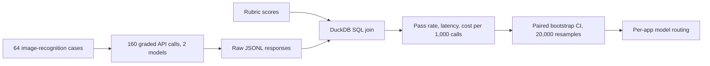

# Vision LLM Evaluation Study

A benchmark of two production LLMs on image recognition for 10 iOS scanner apps, measuring quality, latency and cost to choose models per app.

**Status:** completed study.

> This repository is a README-only write-up; analysis code and data are private. Happy to walk through the work live: [adk08644@gmail.com](mailto:adk08644@gmail.com).

## Problem

Picking a vision model on a few eyeballed examples hides both quality gaps and cost. The goal was a measured comparison that supports a per-app routing decision.

## Method

- 2 production LLMs, 64 cases, 160 graded API calls
- Raw JSONL responses joined with rubric scores in DuckDB SQL
- Pass rate, latency and cost reported with a paired bootstrap confidence interval (20,000 resamples); Wilson intervals were used in the 30-call pilot

## Results

| Strategy | Pass rate | Cost per 1,000 calls |
|---|---|---|
| Best single model | 81.8% | $1.09 |
| Per-app model routing | 90.9% | $0.61 |

Routing scored a higher pass rate at 44% lower cost per 1,000 calls.

## Limits

The routing figures are in-sample on this 64-case set. They show the method and a benchmark result, not generalized accuracy or product usage.

## Tech stack

Python, DuckDB SQL, pandas, Jupyter.
